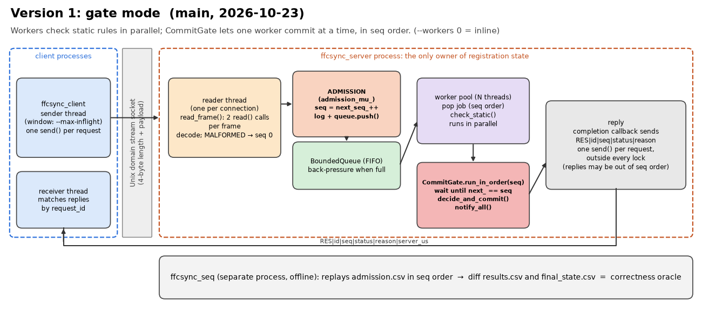
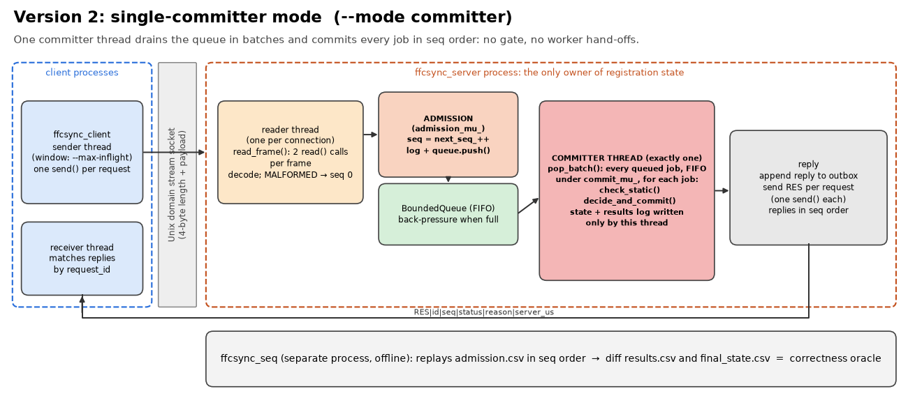
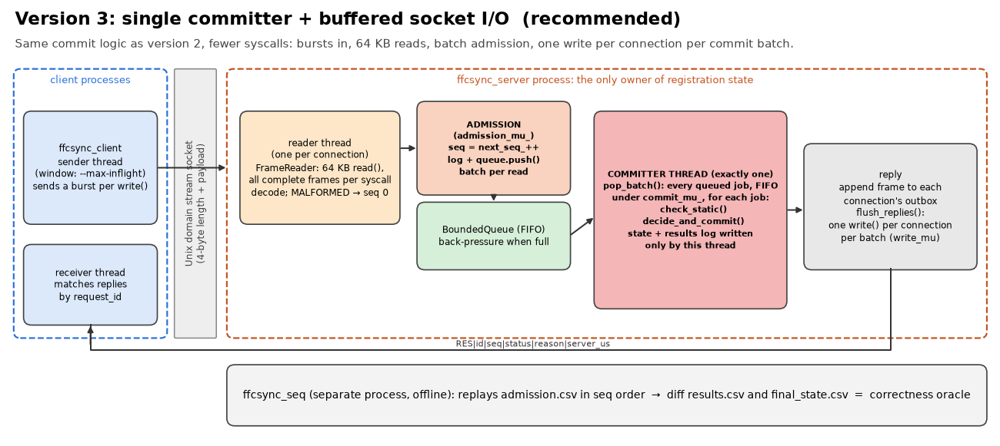
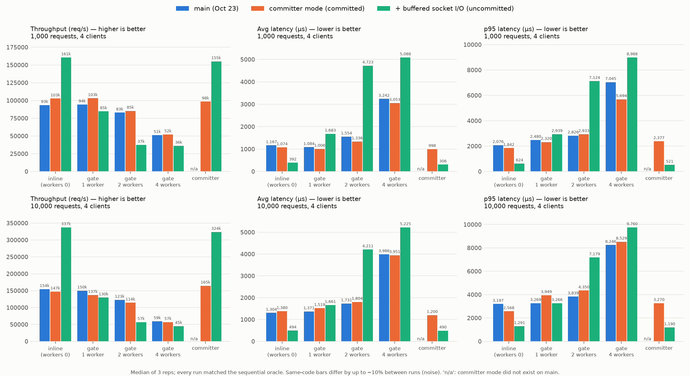
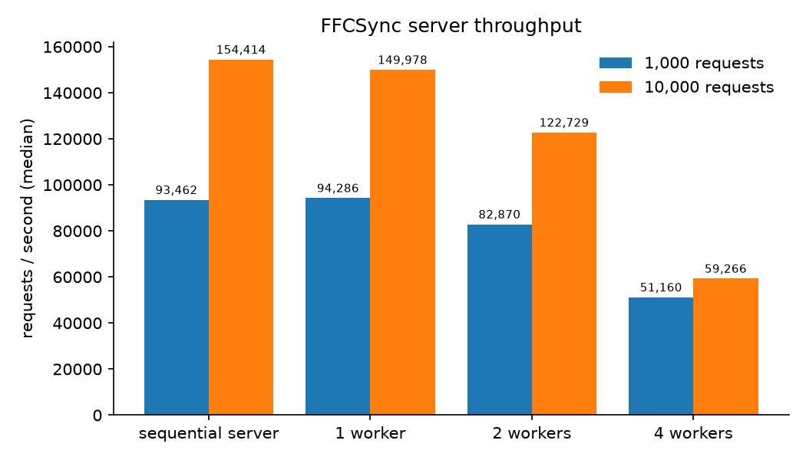
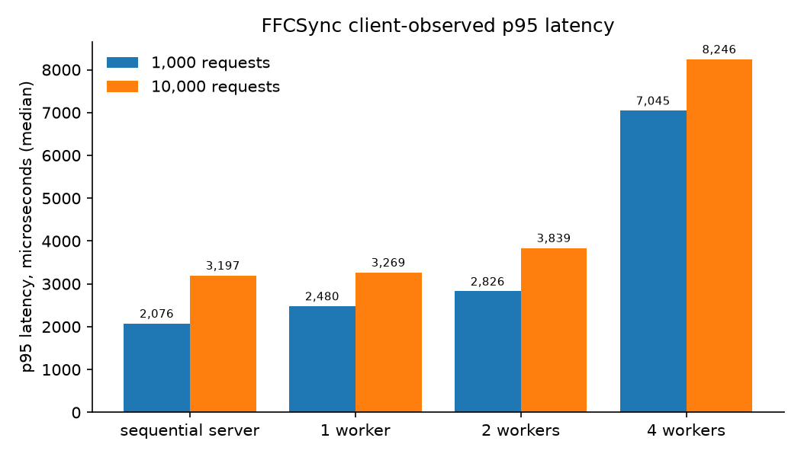

# FFCSync

An Operating Systems teaching project that simulates VIT-style FFCS course registration during a high-demand registration window. A **client process** and a **registration-server process** communicate over a **Unix domain socket**. The server pushes requests through a **bounded FIFO queue** to a **worker-thread pool**, and commits them in strict **FCFS order** through an ordered commit gate. A **sequential reference engine** proves that the concurrent results are correct.

This is a simulation, not a production registration system.

## Three server versions

The server exists in three versions. All three produce results identical to the sequential reference engine; they differ in how requests are committed and how many syscalls they spend.

| Version | Flag | Commit stage | Socket I/O |
|---|---|---|---|
| 1. Gate (`main`, 2026-10-23) | `--mode gate --workers N` (`--workers 0` = inline) | worker pool + `CommitGate` (turn-taking by seq) | one `read`/`send` per message |
| 2. Single committer | `--mode committer` | one committer thread drains the queue in batches | one `send` per reply |
| 3. Committer + buffered I/O (**recommended**) | `--mode committer` | same as version 2 | 64 KB reads, burst writes, one reply write per connection per batch |

### Architecture

**Version 1: gate mode**



**Version 2: single committer**



**Version 3: single committer + buffered socket I/O**



### How FCFS and correctness work

- **Admission point.** A reader thread passes each frame to `ConcurrentEngine::submit_batch()`. Under `admission_mu_` every request gets `seq = next_seq_++`, is appended to the admission log, and is pushed to the FIFO queue. Queue order = seq order = log order. Malformed messages get `seq 0` and never touch state.
- **One commit function.** `decide_and_commit()` in `src/rules.cpp` is the only state transition. The sequential engine and every concurrent mode call it.
- **Static vs. mutable rules.** `check_static()` reads only the immutable catalog and runs without locks. `check_mutable()` (seats, duplicates, clashes, credits, buckets) runs only inside the commit stage, because state changes while a request waits.
- **Commit in seq order.** Gate mode uses `CommitGate::run_in_order(seq, ...)`; committer mode has a single thread consuming the FIFO. Either way the result equals what `ffcsync_seq` produces when it replays `admission.csv`.
- **Lock nesting.** The only nested acquisition is `admission_mu_` → queue mutex.
- **Graceful shutdown.** Close the listener, `SHUT_RD` the readers, join them, drain the queue (`engine.shutdown()`), then write the outputs and check the invariants.

### Rules (first failing rule is reported)

| # | Applies to | Rule | Reason code |
|---|---|---|---|
| 0 | IPC | well-formed `REQ\|id\|ADD/DROP\|student\|section` | `MALFORMED` |
| 1 | all | registration window open | `WINDOW_CLOSED` |
| 2 | all | student exists | `UNKNOWN_STUDENT` |
| 3 | all | section exists | `UNKNOWN_SECTION` |
| 4 | ADD | prerequisites completed | `PREREQ_NOT_MET` |
| 5 | ADD | not already in this section | `ALREADY_REGISTERED` |
| 6 | ADD | not in another section of the same course | `COURSE_ALREADY_TAKEN` |
| 7 | ADD | free seat | `SECTION_FULL` |
| 8 | ADD | no timetable-slot clash | `TIMETABLE_CLASH` |
| 9 | ADD | credits within the semester maximum | `CREDIT_LIMIT` |
| 10 | ADD | bucket credits within the bucket limit | `BUCKET_LIMIT` |
| 11 | DROP | student is registered in this section | `NOT_REGISTERED` |

Rules 1-4 are static, 5-11 are mutable. Credits are integers in tenths (4.0 credits = `40`).

### Wire format

4-byte big-endian length (max 1024) + ASCII payload over a Unix domain stream socket (default `/tmp/ffcsync.sock`).

```text
REQ|<request_id>|<ADD|DROP>|<student_id>|<section_id>        e.g. REQ|R07|ADD|S002|CSE2005-B1
RES|<request_id>|<seq>|<status>|<reason>|<server_us>
```

Identifiers are 1-64 characters from `[A-Za-z0-9-_.:]` because they end up in CSV files.

### Benchmark results

All three versions side by side (median of 3 repetitions, 4 client processes, every run matched the sequential oracle):



Version 1 only (original benchmark, `scripts/bench.py` + `scripts/plot.py`):




Takeaways (WSL2, Ryzen 5 4500U):
- The rules cost under 1 µs per request; the sequential engine alone runs at about 1.1M req/s. Latency and throughput are dominated by syscalls, thread hand-offs and client-side queueing, not by rule evaluation.
- In gate mode, extra workers make things **slower** (10,000 requests: 154k req/s inline, 59k with 4 workers), because commits are serialized and every request pays two extra thread hand-offs plus `notify_all` wake-ups.
- Single-committer mode removes the gate. Adding buffered I/O roughly doubles throughput (about 324-337k req/s at 10,000 requests) and cuts average latency to about 300-500 µs.
- Same-code bars differ by up to about 10% between runs (noise).

## Setup (Linux or WSL2 Ubuntu)

```bash
sudo apt install build-essential cmake python3 python3-venv   # g++ with C++20, CMake >= 3.20
```

No other dependencies are needed. The test framework (doctest 2.4.11) is vendored in `third_party/`. matplotlib is only needed for the optional plotting script.

## Build and test

```bash
cmake -S . -B build
cmake --build build -j
ctest --test-dir build --output-on-failure
```

## Run

```bash
# Sequential reference engine on a request file
./build/ffcsync_seq run --data data --requests data/workloads/basic.csv --out results/seq

# Server (Ctrl-C or SIGTERM for graceful shutdown)
./build/ffcsync_server --mode committer --data data --socket /tmp/ffcsync.sock \
                       --out results/server --verbose                       # versions 2/3
./build/ffcsync_server --mode gate --workers 4 --queue-capacity 64 \
                       --data data --socket /tmp/ffcsync.sock --out results/server   # version 1; --workers 0 = inline

# Clients (in another terminal)
./build/ffcsync_client --op ADD --student S005 --section HUM1021-A2        # one request
./build/ffcsync_client --raw "REQ|x|JOIN|S001|CSE2005-A1"                   # malformed message
./build/ffcsync_client --requests data/workloads/basic.csv --out results/client.csv

# After stopping the server: verify it against the sequential reference
./build/ffcsync_seq replay --data data --admission-log results/server/admission.csv --out results/oracle
diff results/server/results.csv results/oracle/results.csv
```

## Demonstration

```bash
scripts/demo.sh
```

The demo shows one accepted request, one rule violation, one malformed message, and **two client processes racing for the last seat** of `CSE2005-B1`. It then shuts down gracefully, checks the invariants, and compares the server's output with the sequential replay. Outputs go to `results/demo/`. `scripts/demo.sh build committer` runs the same demo against the single-committer server, whose verbose log shows each commit batch.

### Live stress test

```bash
python3 scripts/live_stress.py          # open http://localhost:8765/ and press Start
```

It runs the server in each mode one after another (default: gate with 4 workers, inline, single committer), with 4 client processes sending continuously. Throughput, average and p95 latency are drawn live in the browser. After each mode, the server is stopped and checked: invariants, and results identical to the sequential replay. Options: `--seconds`, `--clients`, `--max-inflight`, `--modes gate:N inline committer`, `--autostart`. No extra dependencies.

## Benchmark

```bash
python3 scripts/bench.py                                      # results/bench/metrics.csv + summary.md
python3 -m venv .venv && .venv/bin/pip install matplotlib     # once
.venv/bin/python scripts/plot.py                              # results/bench/*.png
.venv/bin/python scripts/arch_diagrams.py                     # assets/arch_*.png
```

`assets/` holds the images used by this README (copied from the git-ignored `results/`).

## Layout

```text
include/ffcsync/   public headers (model, rules, engines, queue, gate, IPC, server)
src/               library implementation (ffcsync_core)
apps/              ffcsync_seq, ffcsync_server, ffcsync_client
tests/             doctest suites + two-process integration script
data/              example catalog and workloads (+ golden expected outputs)
scripts/           workload generator, benchmark, plots, diagrams, demo, live stress test
assets/            images used by this README
results/           generated output (not hand-edited, git-ignored)
```
